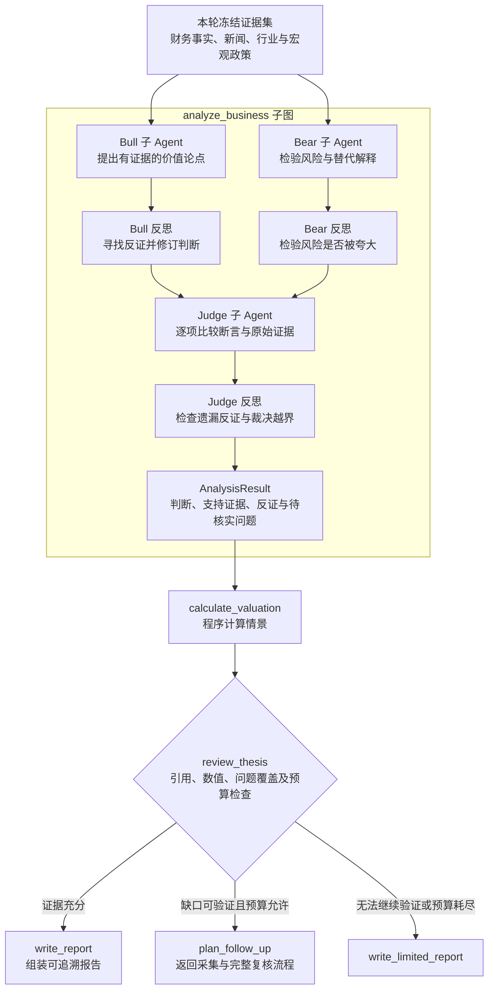

# DeepValue

面向价值投资的 DeepResearch 研究工作台。以**单家公司、固定研究截止日、明确行业范围**为研究边界，围绕财报、新闻、宏观政策与行业资料构建研究流程，输出可追溯的经营观察、风险与可复算的估值情景。

当前为原型版本，默认研究对象为 Caterpillar（CAT）。主流程已跑通，证据覆盖与判断审查仍需完善，不能将报告生成成功等同于研究结论充分。

## 当前研究范围

| 项目 | 当前支持 |
|---|---|
| 市场与行业 | 美股机械制造业，SEC SIC 3500–3599 |
| 研究对象 | 单家公司，校验证券代码与 SEC CIK |
| 截止日 | 用户指定，以美国东部日终为界 |
| 财务历史 | 截止日前披露的 3–5 个年度报告 |
| 新闻与行业 | 搜索候选网页，抓取正文并检查发布日期及已知修改日期 |
| 政策 | Federal Register 官方摘要 |
| 估值 | 近三年披露稀释 EPS 中位数 × 用户设定 PE |
| 输出 | 研究报告、财务数据、证据清单、执行记录、Markdown 与 JSON 导出 |

目前不支持全部制造业、金融行业、多公司筛选、宏观经济时间序列、截止日股价、安全边际、DCF 或自动交易。

## 核心能力

- **财务事实提取**：读取 SEC 申报目录和 XBRL Company Facts，保留会计概念、单位、期间、披露日及 accession。
- **财务质量检查**：检查数据缺失、数值冲突、期间一致性和资产负债平衡；发现截止日前的相关修订时阻断估值，等待核对。
- **证据时间检查**：排除日期缺失、日期冲突、发布或已知修改时间晚于截止日的网页。
- **经营与风险分析**：模型依据提供的资料生成带引用的判断，并列出待核实问题。
- **引用检查**：检查引用片段是否出现在提供的证据中；当前尚不能保证原文充分支持整条判断。
- **确定性估值**：程序计算三组 PE 情景及 EPS 上下浮动 20% 的敏感性结果。
- **有限研究报告**：采集失败或资料不足时保留明确缺口，不用模型生成数字补齐财务事实。

## 目标架构

以下为 DeepValue 的最终目标架构，也是后续 SpecDD 改造的设计依据。图中的宏观数据、政策原文、市场数据、定向修复和结论补查等能力尚未全部实现；当前可用范围见前文。


### 节点职责与研究闭环

| 阶段 | 节点 | 职责 |
|---|---|---|
| 范围与规划 | `define_scope`、`plan_research` | 锁定标的、截止日、行业与预算，将研究目标转为问题和数据需求 |
| 任务分发 | `dispatch_tasks` | 根据待执行任务选择采集能力，补查时只分发所需任务 |
| 数据采集 | `collect_financials`、`collect_news`、`collect_macro_policy`、`collect_industry` | 分别获取财报公告与市场数据、公司事件、宏观政策、行业及竞争对手资料 |
| 证据整理 | `normalize_evidence` | 汇合本轮任务结果，统一口径、去重并关联原始来源 |
| 数据门禁 | `validate_evidence` | 判断关键数据是否具备可用的时间、口径、来源与完整性 |
| 数据修复 | `plan_data_repair` | 为具体缺失或冲突生成定向获取任务 |
| 分析与计算 | `analyze_business`、`calculate_valuation` | 形成有证据的经营判断，以程序执行适用的估值计算 |
| 结论审查 | `review_thesis` | 审查证据是否支持判断，识别反证、冲突及可验证缺口 |
| 补充研究 | `plan_follow_up` | 将结论层面的缺口转成补充任务，返回采集与完整复核流程 |
| 报告出口 | `write_report`、`write_limited_report` | 分别呈现证据充分的结论，或尚未解决的缺口与结论边界 |

两条循环承担不同职责：

- **数据修复循环**：解决关键数据缺失、口径冲突等输入问题，发生在经营分析之前。
- **补充研究循环**：解决已有分析缺少支持、存在反证等结论问题，发生在结论审查之后。

两条循环共用研究预算，并记录任务、来源、失败原因及停止依据。无法取得关键数据、无法继续验证或预算耗尽时，进入有限报告；不得无限重试，也不得通过模型补数或放宽证据标准形成完整结论。有限报告保留已核验的事实，并明确哪些判断或估值无法给出。

### analyze_business：多角色分析子图

目标设计是在 `analyze_business` 内部编排 Bull、Bear、Judge 三个子 Agent，并为每个角色设置反思步骤。子 Agent 是承担任务的执行角色；子图是组织角色、反思、汇合和输出的流程，节点也可以是普通校验函数。三个角色可以使用同一底层模型，不因此构成三个独立信息来源。

以下属于待规约化的架构方案，当前原型尚未实现。主流程在数据门禁通过后，将本轮冻结证据交给子图；子图返回结构化分析结果，再由主流程计算估值、审查和生成报告。



| 角色 | 首轮职责 | 反思要求 |
|---|---|---|
| Bull | 提出经营、现金流与资本配置方面最有支持的价值论点 | 找出最脆弱前提、反证及失效条件，必要时撤回或缩小判断 |
| Bear | 识别周期、财务口径、竞争和政策风险，提出替代解释 | 区分可能风险与已发生事实，检查削弱风险判断的证据 |
| Judge | 按原子断言对照双方观点和原始证据，裁定支持、不支持或未决 | 检查遗漏反证、缺失前提和虚假平衡，保留无法裁定的问题 |

角色不要求强制看多、看空或选出赢家；证据不足时允许没有结论。Bull 与 Bear 首轮独立作答，不读取对方草稿；Judge 在双方反思完成后汇合审查。

#### 证据与输出契约

- 三个角色使用同一份带版本号的证据集，引用 `evidence_id` / `fact_id`；不自行联网、补数字或改变研究截止日。
- 每条判断记录类型（事实、派生事实、推断）、前提、支持证据、反证、假设及未解问题；反思记录保留、修订或撤回的判断及理由。
- Judge 返回逐条裁决和具体缺口，不以投票或角色共识替代来源验证。多个角色引用同一来源，独立来源数仍为一。
- Judge 负责证据与解释的支持关系；主流程 `review_thesis` 负责引用定位、数值/期间核验、问题覆盖和补查路由。程序能够确定性核验的规则仍由程序执行。
- 最终报告消费主流程审查通过的判断、程序计算的估值及未解缺口；报告阶段不得重新引入被撤回的观点或生成无来源的新结论。
- 补查取得新证据后生成新的证据版本，重新执行子图、估值和审查；旧裁决不能直接沿用。

#### 反思实现与调用预算

逻辑上的反思节点不必各自增加一次模型调用。第一版建议每个角色在一次结构化调用中输出初判、反证检查和修订结果，再由反思节点执行字段、引用及修订记录校验。这样每轮三次模型调用，两轮六次；现有八次模型尝试上限还可容纳两次符合条件的网络重试，重试额度由整个运行共享。

这种实现属于角色自检，不是独立模型复核。如果六个角色/反思节点各调用模型一次，每轮将需要六次、两轮十二次，尚未包含重试；采用该方案前必须先修订总规约中的调用与时间预算。Judge 承担语义审查，主流程不得再隐式增加一轮模型审查而不计预算。

#### SpecDD 落地与验收

实施前先修订 [DV-09 经营分析](./specs/09-business-analysis.md)、[DV-10 结论审查](./specs/10-claim-review.md) 和 [总规约](./specs/00-system-contract.md) 中的角色输出、模型预算与路由规则；本文新增方案不表示现有 Accepted 规约已同步变更。

首要验收样本为“引用真实、推断过度”：例如单年经营现金流高于净利润，只能支持该年度的数值关系；若据此断言长期盈利质量强劲或具备护城河，应撤回过度判断，并将营运资本变化、持续性等缺失前提转为可验证的补查问题。反方的替代解释同样需要证据，不能直接升级为事实。

### 当前实现与目标差异

当前原型先获取财报，再并行采集新闻、行业和政策摘要，最多执行两轮采集。补查主要针对缺失类别，尚未形成上述两条独立闭环。

| 目标能力 | 当前状态 |
|---|---|
| 财报、公告与市场数据统一采集 | 已接入 SEC 年度财报与 XBRL 数据；公告与市场数据尚未形成完整能力 |
| 独立的新闻、行业与竞争对手研究 | 新闻与行业共用网页采集实现，竞争对手研究未独立建模 |
| 宏观数据与政策原文 | 仅接入政策官方摘要，宏观时间序列与政策全文核验尚未实现 |
| 定向数据修复 | 关键财务数据不合格时直接输出有限报告 |
| 结论驱动的补充研究 | 目前按缺失证据类别补查 |
| Bull / Bear / Judge 分析与反思子图 | 当前仍为单次模型分析，尚未实现多角色编排；新增方案需先修订相关 spec |
| 证据对结论的支持性审查 | 当前主要检查引用片段是否存在 |
| 独立的完整与有限报告出口 | 当前由同一个报告节点根据缺口生成不同状态的报告 |

## 默认示例

| 参数 | 默认值 |
|---|---|
| 公司 | Caterpillar |
| 证券代码 | CAT |
| SEC CIK | 18230 |
| 研究截止日 | 2025-03-01 |
| 历史财年 | 3 年 |
| 采集轮次 | 最多 2 轮 |
| PE 假设 | 10 / 15 / 20 |

可使用以下研究重点：

> 基于截止日前已披露的资料，分析卡特彼勒的盈利质量、行业周期与资本配置。区分披露事实和推断，主动寻找反面证据，并列明尚未解决的问题。

这些 PE 是用户假设，不代表同业统计或经验证的合理估值倍数。

## 本地运行（macOS）

需要 Python 3.11+、Node.js 与 npm，以及可用的大模型服务和已配置的 MCP 搜索应用。命令均在 DeepValue 仓库根目录执行。

### 1. 安装依赖

```bash
python3 -m venv backend/.venv
backend/.venv/bin/python -m pip install -r backend/requirements-lock.txt
backend/.venv/bin/python -m pip install --no-deps -e ./backend
npm ci --prefix frontend
```

### 2. 配置服务

首次配置时，将示例复制为本地配置；已有 `backend/.env` 时直接编辑，避免覆盖现有设置：

```bash
cp backend/.env.example backend/.env
```

| 配置项 | 说明 |
|---|---|
| `APP_TOKEN` | 当前实现用于模型及 MCP 应用调用的凭据 |
| `LLM_BASE_URL` | OpenAI 兼容模型服务地址 |
| `MCP_APP_ID` | 已配置网页搜索工作流的应用 ID |
| `AVAILABLE_MODELS` | 模型列表 JSON，填写实际账号可调用的模型 |
| `WEB_SEARCH_MAX_QPS` | 搜索调用限速 |
| `SEC_USER_AGENT` | 可在 .env 中添加，用于 SEC 请求的应用标识及真实联系信息 |

示例模型列表结构：

```json
[
  {
    "model_id": "替换为可用模型ID",
    "display_name": "研究模型",
    "icon": "Zap",
    "icon_color": "yellow-400"
  }
]
```

MCP 应用必须符合当前搜索解析协议：输出 MCP 结果 JSON 后紧接请求数量，文本结果中包含 `status` 与 `pages`，每个页面提供 `title`、`url`、`snippet`。仅填写应用 ID 并不代表搜索工作流已配置完成。

研究财年数和轮次由页面请求控制；示例配置中的旧变量 `NUMBER_OF_INITIAL_QUERIES`、`MAX_RESEARCH_LOOPS` 不控制当前 DeepValue 流程。

### 3. 启动与停止

```bash
bash run.sh
```

- 页面：<http://127.0.0.1:5173/app/>
- 后端：<http://127.0.0.1:2024>
- LangGraph 图 ID：`deepvalue`
- 日志：`.run/backend.log` 与 `.run/frontend.log`

在启动终端按 `Ctrl+C` 停止前后端。后台运行时，可从仓库根目录执行：

```bash
kill -TERM "$(cat .run/app.pid)"
```

页面中的“停止研究”当前会停止接收本次研究，已发出的外部请求可能仍在结束中；它不等同于停止本地服务。

前端构建命令：

```bash
npm run build --prefix frontend
```

## 项目结构

```text
DeepValue/
├── backend/
│   ├── src/agent/
│   │   ├── value/
│   │   │   ├── models.py       # 研究请求与流程状态
│   │   │   ├── sec.py          # SEC 财报与财务事实
│   │   │   ├── evidence.py     # 网页与政策资料
│   │   │   ├── valuation.py    # PE 情景计算
│   │   │   └── workflow.py     # 研究编排、审查与报告
│   │   ├── graph.py            # 图入口
│   │   ├── app.py              # 模型列表与 HTTP 应用
│   │   ├── base_agent.py       # 模型及 MCP 调用
│   │   └── llm/               # 模型服务接入
│   ├── langgraph.json
│   └── requirements-lock.txt
├── frontend/
│   ├── src/App.tsx            # 研究工作台
│   ├── src/deepvalue.css      # 页面样式
│   └── package-lock.json
├── run.sh
├── run_backend.sh
└── run_fontend.sh
```

当前仍沿用部分基础项目的目录与组件，尚未完成能力模块化改造。

## 数据与结论边界

1. **历史可见性**：财务事实按披露日和原始申报筛选；公司身份与行业来自当前 SEC 元数据。当前抓取的历史网页不等于历史归档，本项目不是无前视偏差的回测数据集。
2. **证据覆盖**：新闻和行业网页可能因日期或正文问题全部被排除。已有 CAT 验证结果出现过两类有效证据均为 0，报告会显示有限结论。
3. **判断可靠性**：引用匹配仅证明片段存在，不能证明因果关系、盈利质量或护城河等推断成立。
4. **财务口径**：合并净利润采用含非控股权益的 ProfitLoss；经营现金流减固定资产支出不能直接视为完整自由现金流。
5. **估值适用性**：EPS 未剔除一次性损益，中位数不等于正常化盈利。三年内存在非正 EPS 或关键财务数据未通过检查时，不执行当前估值方法。
6. **政策口径**：官方摘要不证明政策已生效或适用于公司；当前没有宏观经济数据序列。
7. **金融分部**：合并报表可能包含金融业务，当前不据此构造工业分部 DCF。

输出用于辅助研究，PE 情景值不应被当作已确认的公允价值、目标价或买卖指令。

## 后续改造方式

采用 **SpecDD：先规约、再实现、再特征测试**。

规约见 [specs 索引](./specs/README.md)，包含总规约、15 份能力 spec、迁移矩阵和验收矩阵。规约不代表对应业务实现或特征测试已经完成。

以目标架构为依据，将研究范围、公司身份、研究规划与任务分发、财报及市场数据、新闻、宏观政策、行业与竞争对手、证据标准化与校验、定向数据修复、经营分析、估值、结论审查与补充研究、报告、运行编排、前端和外部接入拆为独立能力，每个能力对应一份 spec。先统一输入输出、预算、失败状态与报告出口，再迁移实现，最后按验收场景验证。

重点验收两条闭环：数据修复后重新校验，补充研究后重新分析、计算与审查；同时覆盖关键数据不可得、预算耗尽及有限报告出口。宏观数据还需明确历史发布与修订版本规则，政策原文需区分发布、生效和公司适用性。

当前基线标签为 `baseline-prototype`。上述模块化设计属于后续计划，不表示已完成实现。

## 本地配置与数据

`backend/.env`、虚拟环境、`node_modules/`、运行日志及 `.run/` 数据均不纳入版本管理。提交前应检查文件内容，避免把凭据写入源码、配置示例或文档。

## 分支、协作与版本发布

- `main`：发布分支；`dev`：开发集成分支。两者通过 PR 更新，要求 CI 通过，禁止强制推送和删除。
- 从 `dev` 创建 `codex/<feature>` 特性分支，关联 Issue 与 spec；完成后提 PR 合并回 `dev`。
- SpecDD 顺序为规约、实现、特征测试。CI 当前检查前端构建、后端语法与图加载，不代表特征测试已覆盖；能力测试落地后纳入 CI。
- 每个能力用 Issue 跟踪范围、依赖和验收；缺陷 Issue 提供复现步骤，禁止附带敏感信息。
- 每个变更同步相关文档及 [CHANGELOG.md](./CHANGELOG.md) 的 Unreleased 条目。
- 版本就绪后，从 `dev` 提 PR 到 `main`；将 Unreleased 条目归入版本号与日期，合并通过后在该提交上打 `vX.Y.Z` 标签并创建 GitHub Release。
- 发布采用保留历史的 merge commit，发布后将 `main` 经 PR 同步回 `dev`，保持分支历史一致。
- 个人开发阶段不强制他人审批，但仍要求 PR、CI 与讨论解决。
