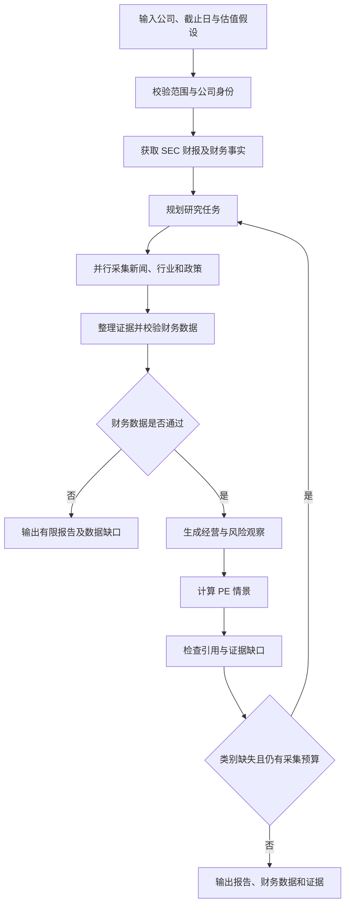

# DeepValue

面向价值投资的 DeepResearch 研究工作台。以**单家公司、固定研究截止日、明确行业范围**为研究边界，连接财报、新闻、行业与政策资料，输出可追溯的经营观察、风险与可复算的估值情景。

当前为原型版本，默认研究对象为 Caterpillar（CAT）。主流程已跑通，证据覆盖与判断审查仍需完善，不能将报告生成成功等同于研究结论充分。

## 当前研究范围

| 项目 | 当前支持 |
|---|---|
| 市场与行业 | 美股机械制造业，SEC SIC 3500–3599 |
| 研究对象 | 单家公司，校验证券代码与 SEC CIK |
| 截止日 | 用户指定，以美国东部日终为界 |
| 财务历史 | 截止日前披露的 3–5 个年度报告 |
| 新闻与行业 | 搜索候选网页，抓取正文并检查发布日期及已知修改日期 |
| 政策 | Federal Register 官方摘要 |
| 估值 | 近三年披露稀释 EPS 中位数 × 用户设定 PE |
| 输出 | 研究报告、财务数据、证据清单、执行记录、Markdown 与 JSON 导出 |

目前不支持全部制造业、金融行业、多公司筛选、宏观经济时间序列、截止日股价、安全边际、DCF 或自动交易。

## 核心能力

- **财务事实提取**：读取 SEC 申报目录和 XBRL Company Facts，保留会计概念、单位、期间、披露日及 accession。
- **财务质量检查**：检查数据缺失、数值冲突、期间一致性和资产负债平衡；发现截止日前的相关修订时阻断估值，等待核对。
- **证据时间检查**：排除日期缺失、日期冲突、发布或已知修改时间晚于截止日的网页。
- **经营与风险分析**：模型依据提供的资料生成带引用的判断，并列出待核实问题。
- **引用检查**：检查引用片段是否出现在提供的证据中；当前尚不能保证原文充分支持整条判断。
- **确定性估值**：程序计算三组 PE 情景及 EPS 上下浮动 20% 的敏感性结果。
- **有限研究报告**：采集失败或资料不足时保留明确缺口，不用模型生成数字补齐财务事实。

## 研究流程



当前最多执行两轮采集。补查主要围绕缺失的新闻、行业和政策类别展开，尚未实现针对每个研究问题的精细化补查。

## 默认示例

| 参数 | 默认值 |
|---|---|
| 公司 | Caterpillar |
| 证券代码 | CAT |
| SEC CIK | 18230 |
| 研究截止日 | 2025-03-01 |
| 历史财年 | 3 年 |
| 采集轮次 | 最多 2 轮 |
| PE 假设 | 10 / 15 / 20 |

可使用以下研究重点：

> 基于截止日前已披露的资料，分析卡特彼勒的盈利质量、行业周期与资本配置。区分披露事实和推断，主动寻找反面证据，并列明尚未解决的问题。

这些 PE 是用户假设，不代表同业统计或经验证的合理估值倍数。

## 本地运行（macOS）

需要 Python 3.11+、Node.js 与 npm，以及可用的大模型服务和已配置的 MCP 搜索应用。命令均在 DeepValue 仓库根目录执行。

### 1. 安装依赖

```bash
python3 -m venv backend/.venv
backend/.venv/bin/python -m pip install -r backend/requirements-lock.txt
backend/.venv/bin/python -m pip install --no-deps -e ./backend
npm ci --prefix frontend
```

### 2. 配置服务

首次配置时，将示例复制为本地配置；已有 `backend/.env` 时直接编辑，避免覆盖现有设置：

```bash
cp backend/.env.example backend/.env
```

| 配置项 | 说明 |
|---|---|
| `APP_TOKEN` | 当前实现用于模型及 MCP 应用调用的凭据 |
| `LLM_BASE_URL` | OpenAI 兼容模型服务地址 |
| `MCP_APP_ID` | 已配置网页搜索工作流的应用 ID |
| `AVAILABLE_MODELS` | 模型列表 JSON，填写实际账号可调用的模型 |
| `WEB_SEARCH_MAX_QPS` | 搜索调用限速 |
| `SEC_USER_AGENT` | 可在 .env 中添加，用于 SEC 请求的应用标识及真实联系信息 |

示例模型列表结构：

```json
[
  {
    "model_id": "替换为可用模型ID",
    "display_name": "研究模型",
    "icon": "Zap",
    "icon_color": "yellow-400"
  }
]
```

MCP 应用必须符合当前搜索解析协议：输出 MCP 结果 JSON 后紧接请求数量，文本结果中包含 `status` 与 `pages`，每个页面提供 `title`、`url`、`snippet`。仅填写应用 ID 并不代表搜索工作流已配置完成。

研究财年数和轮次由页面请求控制；示例配置中的旧变量 `NUMBER_OF_INITIAL_QUERIES`、`MAX_RESEARCH_LOOPS` 不控制当前 DeepValue 流程。

### 3. 启动与停止

```bash
bash run.sh
```

- 页面：<http://127.0.0.1:5173/app/>
- 后端：<http://127.0.0.1:2024>
- LangGraph 图 ID：`deepvalue`
- 日志：`.run/backend.log` 与 `.run/frontend.log`

在启动终端按 `Ctrl+C` 停止前后端。后台运行时，可从仓库根目录执行：

```bash
kill -TERM "$(cat .run/app.pid)"
```

页面中的“停止研究”当前会停止接收本次研究，已发出的外部请求可能仍在结束中；它不等同于停止本地服务。

前端构建命令：

```bash
npm run build --prefix frontend
```

## 项目结构

```text
DeepValue/
├── backend/
│   ├── src/agent/
│   │   ├── value/
│   │   │   ├── models.py       # 研究请求与流程状态
│   │   │   ├── sec.py          # SEC 财报与财务事实
│   │   │   ├── evidence.py     # 网页与政策资料
│   │   │   ├── valuation.py    # PE 情景计算
│   │   │   └── workflow.py     # 研究编排、审查与报告
│   │   ├── graph.py            # 图入口
│   │   ├── app.py              # 模型列表与 HTTP 应用
│   │   ├── base_agent.py       # 模型及 MCP 调用
│   │   └── llm/               # 模型服务接入
│   ├── langgraph.json
│   └── requirements-lock.txt
├── frontend/
│   ├── src/App.tsx            # 研究工作台
│   ├── src/deepvalue.css      # 页面样式
│   └── package-lock.json
├── run.sh
├── run_backend.sh
└── run_fontend.sh
```

当前仍沿用部分基础项目的目录与组件，尚未完成能力模块化改造。

## 数据与结论边界

1. **历史可见性**：财务事实按披露日和原始申报筛选；公司身份与行业来自当前 SEC 元数据。当前抓取的历史网页不等于历史归档，本项目不是无前视偏差的回测数据集。
2. **证据覆盖**：新闻和行业网页可能因日期或正文问题全部被排除。已有 CAT 验证结果出现过两类有效证据均为 0，报告会显示有限结论。
3. **判断可靠性**：引用匹配仅证明片段存在，不能证明因果关系、盈利质量或护城河等推断成立。
4. **财务口径**：合并净利润采用含非控股权益的 ProfitLoss；经营现金流减固定资产支出不能直接视为完整自由现金流。
5. **估值适用性**：EPS 未剔除一次性损益，中位数不等于正常化盈利。三年内存在非正 EPS 或关键财务数据未通过检查时，不执行当前估值方法。
6. **政策口径**：官方摘要不证明政策已生效或适用于公司；当前没有宏观经济数据序列。
7. **金融分部**：合并报表可能包含金融业务，当前不据此构造工业分部 DCF。

输出用于辅助研究，PE 情景值不应被当作已确认的公允价值、目标价或买卖指令。

## 后续改造方式

采用 **SpecDD：先规约、再实现、再特征测试**。

计划将研究范围、公司身份、财报、财务事实、研究计划、网页研究、政策、证据、经营分析、判断审查、估值、报告、运行编排、前端与外部接入拆为独立能力，每个能力对应一份 spec。先统一输入输出与失败状态，再迁移实现，最后按验收场景验证。

当前基线标签为 `baseline-prototype`。上述模块化设计属于后续计划，不表示已完成实现。

## 本地配置与数据

`backend/.env`、虚拟环境、`node_modules/`、运行日志及 `.run/` 数据均不纳入版本管理。提交前应检查文件内容，避免把凭据写入源码、配置示例或文档。
