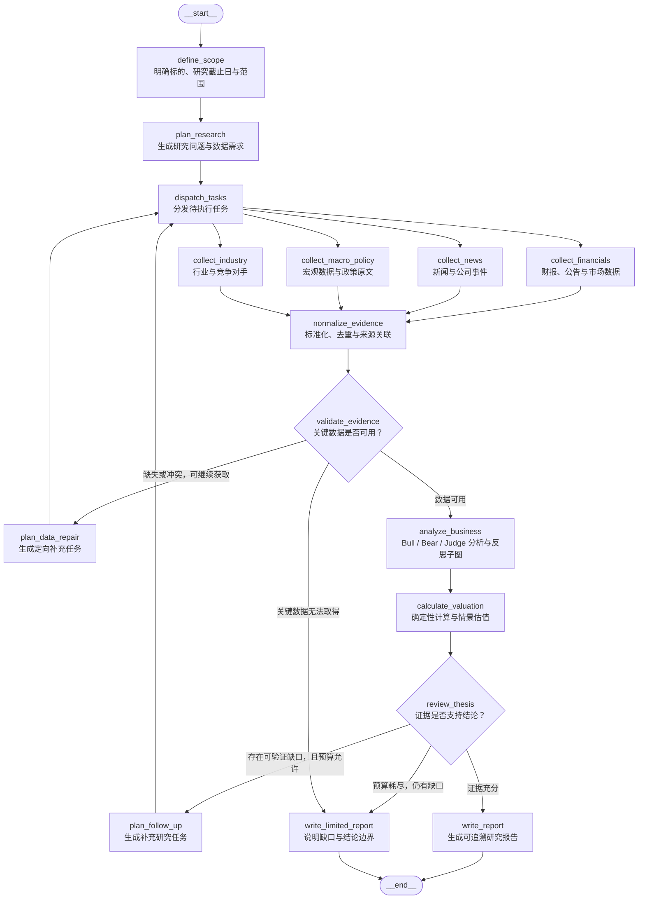
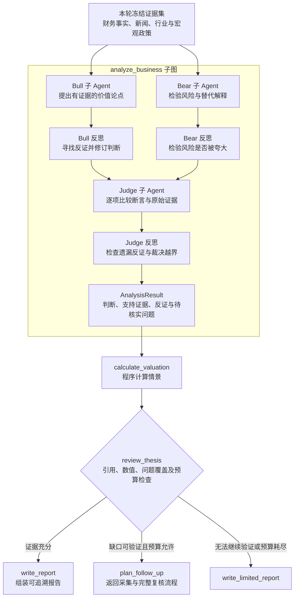

# DeepValue

面向价值投资的 DeepResearch 研究工作台。

DeepValue 围绕**一家公司、一个固定研究截止日、一组可验证的问题**组织研究：从财报、公告、新闻、宏观政策和行业资料中建立证据集，以 Bull / Bear / Judge 多角色分析检验投资论点，再用确定性计算形成估值情景，最终输出结论、反证、失效条件与证据缺口。

默认研究对象为 **Alphabet Class A（GOOGL）**，CIK `1652044`。研究关注广告与云业务、AI 资本开支、盈利质量、资本配置及监管风险。GOOG 与 GOOGL 属于不同股类，未来接入价格时必须保持股类口径一致。

> 本文以目标产品与架构为主。目标能力按 SpecDD 逐步落地，当前实现状态单独列于文末；架构图不代表所有节点已经实现。

## 产品要回答的问题

- 公司靠什么创造价值，增长与竞争优势由哪些事实支持？
- 盈利、现金流和资本配置是否支持经营判断？
- 行业、技术替代、宏观环境和政策带来了哪些风险？
- 支持当前论点的最强证据与最强反证分别是什么？
- 哪些假设决定估值情景，什么条件会使判断失效？
- 截止日之前还有哪些关键资料没有取得，结论应限定到什么程度？

报告面向研究与复核。估值情景的假设、数据和计算过程必须可检查。

## 整体研究架构

主流程负责范围、任务、预算、证据和报告出口；分析子图负责从同一证据集形成并检验解释。
财报、公告与市场数据在目标中由同一采集能力协调；行情接口、股价比较及安全边际仍是后续增量，不属于当前首版估值范围。



### 两条研究闭环

| 闭环 | 触发原因 | 处理方式 | 停止条件 |
|---|---|---|---|
| 数据修复 | 关键事实缺失、期间或单位冲突、来源不可用 | `plan_data_repair` 生成定向任务，重新采集、标准化及校验 | 已解决，或无新任务、关键数据不可得、预算耗尽 |
| 补充研究 | 判断缺前提、反证未解释、政策适用性未明确 | `plan_follow_up` 生成问题驱动任务，重新采集并重跑分析、估值和审查 | 证据充分，或无法继续验证、预算耗尽 |

两条闭环共享运行预算，不因进入另一条循环而重置。补查只针对具体缺口；新证据形成新版本，旧分析和旧裁决不能直接沿用。无法继续时输出有限报告，说明保留的事实、未解问题和停止依据。

### 数据来源与资格

| 资料 | 目标用途 | 必须保留的边界 |
|---|---|---|
| SEC 年报、季报与公告 | 财务事实、管理层披露和重大事件 | 披露日、期间、accession、会计概念、单位及修订 |
| 公司投资者关系与新闻正文 | 公司事件、资本配置与催化因素 | 主体相关性、原始来源、发布日期、已知修改时间及新闻归因 |
| FRED 历史版本 | 工业生产等宏观背景 | 观测期、截止日可见版本、单位、频率与修订，首个规划序列为 INDPRO |
| 政策原文 | 监管变化与可能影响 | 发布、生效和公司适用性分别核验，摘要不能替代全文 |
| 行业与竞争对手资料 | 需求变化、竞争关系与替代解释 | 主题相关性、公司关联和来源独立性 |

研究截止日以美国东部日终为界。网页日期合格不代表它是历史归档；保存快照也不自动构成严格的历史可见性数据库。未来历史版本能力需要按来源分别验收。

## 多角色分析与反思

`analyze_business` 是一个 LangGraph 子图，其中 Bull、Bear、Judge 是执行角色。子图组织并行、反思、汇合与结构化输出，普通校验节点不必调用模型。



### 角色职责

| 角色 | 分析职责 | 反思职责 |
|---|---|---|
| Bull | 提出最有证据支持的价值论点和经营解释 | 找出脆弱前提、反证与失效条件，必要时缩小或撤回判断 |
| Bear | 提出风险、竞争威胁和替代解释 | 检查是否夸大风险，区分可能发生与已经发生 |
| Judge | 对照双方断言及原始证据，给出支持、不支持或未决裁决 | 检查遗漏反证、缺失前提与裁决越界，保留尚不能解决的问题 |

Bull 与 Bear 首轮独立作答，Judge 在双方反思完成后汇合。角色可以没有结论，不强制看多、看空或选出赢家。三个角色可以使用同一模型，其共识不构成独立来源验证。

### 反思与预算

首版设计由每个角色在一次结构化调用中输出**初判 → 反证检查 → 修订后判断**；反思节点用程序验证字段、引用和撤回记录。每轮三次逻辑调用，两轮六次；整个研究最多八次模型尝试，网络重试共享剩余额度。

该方式属于角色自检。若未来改为反思节点单独调用模型，必须先修订预算和验收标准。Judge 承担语义支持检查，主流程不再隐式增加一轮模型审查。

角色只能读取本轮冻结证据，不自行联网或生成财务数值。前置角色结构失败时不能把草稿送 Judge 当作有效输入，必须记录分析缺口。

## 证据、判断与计算契约

目标数据流为：

```text
来源资料
  → 财务事实 / 证据登记（来源、期间、时间资格与内容版本）
  → 冻结证据集
  → Bull / Bear / Judge（前提、支持证据、反证、反思与裁决）
  → 确定性估值 + 主流程门禁
  → 完整报告 / 有限报告
```

- **事实**保留来源定位、概念、单位和期间；缺失不填零，冲突不任意选值。
- **派生事实**保留公式、输入事实和计算版本，由程序计算。
- **推断**列出前提、假设、反证和适用边界，引用 `evidence_id` / `fact_id`。
- **反思记录**保留判断的保留、修订或撤回理由，撤回观点不得在报告中重新出现。
- **Judge 裁决**回答证据支持什么；`review_thesis` 核验引用、数值、期间、证据版本、问题覆盖及补查预算。
- **报告**消费审查后的结果，展示来源和缺口，不追加未经检查的新观点。

例如，单年经营现金流高于净利润，可以支持当年的数值关系；要进一步判断长期盈利质量或护城河，需要额外前提和证据。引用匹配只是必要条件。

## 估值与报告出口

首版估值方法为：**近三年披露稀释 EPS 中位数 × 用户设定 PE**，并展示 EPS 上下浮动 20% 的敏感性结果。默认 PE 为 10 / 15 / 20，仅是用户情景，不代表同业统计。

确定性计算独立于模型，保留输入期间、事实引用及舍入规则。关键财务数据不合格时阻断估值；数据完整但存在非正 EPS 时，该方法不适用。EPS 中位数未剔除一次性损益，不能称为正常化盈利。

| 状态维度 | 目标语义 |
|---|---|
| 运行 | 等待、执行、完成、失败、取消 |
| 研究完整性 | 证据充分、有限结论、关键数据阻断 |
| 估值 | 已计算、不适用、被阻断 |

一次运行可以完成并输出有限报告；资料不足必须可见。模型结构失败需明确记录，不截断原文、放宽校验或把失败判断当作成功结果。

目标报告包括：研究范围、财务事实、经营论点、反面证据、Judge 裁决、估值假设与敏感性、失效条件、未解决问题及来源清单。

## 能力模块与技术边界

采用模块化单体，沿用 Python、FastAPI、Pydantic、LangGraph 和 React。每个能力有输入输出和验收契约，不要求每个模块都是 Agent。

| 模块 | 职责 |
|---|---|
| `contracts` | 请求、事实、证据、任务、判断、反思、结果与错误协议 |
| `integrations` | SEC、搜索、FRED、政策与模型供应商协议、超时和错误映射 |
| `capabilities` | 公司、财务、研究计划、证据、分析、审查、估值及报告业务规则 |
| `runtime` | 图编排、并行汇合、共享预算、取消和运行隔离 |
| `api` | 统一研究入口、事件、运行状态及导出 |
| 前端研究工作台 | 输入范围、跟踪研究、查看财务与证据、复核判断和导出 |

依赖方向为 `API / Runtime → Capabilities → Contracts`；供应商通过接入端口装配。模型不直接修改事实，报告不依赖前端内部状态拼装。

当前 `backend/src/agent/` 仍承载原型执行图，`backend/src/deepvalue/` 已开始承载共享基础；以上模块划分是目标结构，按能力逐步迁移。

## 开发路线：SpecDD

坚持 **先规约、再实现、再特征测试**，每个能力通过 Issue 跟踪，并以 PR 和 CI 集成。

| 阶段 | 交付重点 | 放行依据 |
|---|---|---|
| 1. 共享基础 | 请求、配置、错误、接入与共享预算 | 合同明确，错误不静默，固定样本特征测试通过 |
| 2. 可靠数据 | 财报及公告、原始来源、时间资格、宏观与政策 | 关键事实可核对，相关性与日期均合格 |
| 3. 双闭环 | 定向修复、问题驱动补查与停止条件 | 任务不重复、预算不重置、有限出口可验证 |
| 4. 多角色分析 | Bull/Bear/Judge、反思与主流程门禁 | 能撤回过度推断，产生可执行补查问题，成本可解释 |
| 5. 产品闭环 | 统一运行 API、取消、报告和导出 | 页面、状态和导出一致，失败不会混入旧结果 |
| 6. 后续扩展 | 季度深研、行情与安全边际、研究记忆 | 独立需求、数据合同和新增验收通过 |

DeepValue 保持独立开发，按具体需求借鉴其他项目已有实现。首版聚焦单公司与明确行业，不提前引入多公司筛选、全行业适配、DCF 或自动交易。

规约入口：[总规约](./specs/00-system-contract.md) · [能力索引](./specs/README.md) · [经营分析](./specs/09-business-analysis.md) · [结论审查](./specs/10-claim-review.md) · [迁移计划](./specs/migration-plan.md) · [验收矩阵](./specs/acceptance-matrix.md)。

## 当前可运行版本

以下状态描述当前开发分支，尚未全部合并至发布分支。

- 默认 Alphabet / GOOGL，CIK `1652044`，SEC SIC `7370`；默认截止日 `2025-03-01`，支持指定日期及 3–5 个完整财年。
- 已接入 SEC 年度财报、新闻/行业网页和政策摘要；具备 PE 情景、引用/期间/归因检查及 Markdown/JSON 导出。
- 已建立部分共享契约、配置和接入基础，尚未全面替换旧图。
- Bull/Bear/Judge 执行子图、完整数据修复、问题驱动补查、宏观历史序列与政策全文仍待实现。
- 当前没有季度结构化研究、行情比较、安全边际或完整语义支持审查。行业和政策资料可能不足，报告会明确展示缺口。
- 当前“停止研究”主要停止接收结果，后端确认取消仍需完成；当前抓取网页也不构成无前视偏差的历史数据库。

## 本地运行（macOS）

需要 Python 3.11+、Node.js 与 npm。以下命令在仓库根目录执行。

### 安装

```bash
python3 -m venv backend/.venv
backend/.venv/bin/python -m pip install -r backend/requirements-lock.txt
backend/.venv/bin/python -m pip install --no-deps -e ./backend
npm ci --prefix frontend
```

### 配置

首次配置复制示例；已有 `backend/.env` 时直接编辑，保留本地凭据：

```bash
cp backend/.env.example backend/.env
```

| 配置 | 用途 |
|---|---|
| `APP_TOKEN` | 当前模型与 MCP 应用凭据 |
| `LLM_BASE_URL` | OpenAI 兼容服务地址 |
| `MCP_APP_ID` | 符合当前输出协议的搜索工作流 ID |
| `AVAILABLE_MODELS` | 实际可调用的模型列表 JSON |
| `WEB_SEARCH_MAX_QPS` | 搜索限速 |
| `SEC_USER_AGENT` | SEC 请求应用标识与真实联系信息 |
| `FRED_API_KEY` | 新基础配置预留；宏观业务采集尚未接入旧图 |

MCP 搜索应用须输出结果 JSON 后紧接请求数量；文本结果包含 `status`、`pages`，页面包含 `title`、`url`、`snippet`。字段示例见 [配置模板](./backend/.env.example)。页面控制财年和轮次，旧环境变量 `NUMBER_OF_INITIAL_QUERIES`、`MAX_RESEARCH_LOOPS` 不控制当前研究流程。

### 启停与验证

```bash
bash run.sh
```

页面：<http://127.0.0.1:5173/app/>；后端：<http://127.0.0.1:2024>；图 ID：`deepvalue`。日志位于 `.run/backend.log` 和 `.run/frontend.log`。端口已占用时先检查现有服务。

前台运行按 Ctrl+C 停止；后台启动时从仓库根目录执行：

```bash
kill -TERM "$(cat .run/app.pid)"
```

```bash
backend/.venv/bin/python -m pip install -r backend/requirements-dev.txt
backend/.venv/bin/python -m pytest backend/tests -q
npm run build --prefix frontend
```

CI 执行后端测试、图加载及前端构建；通过 CI 不等于真实数据接入或金融语义已全部验收。

## 协作与版本

`dev` 为开发集成分支，特性分支使用 `codex/<feature>`，通过 PR 和 CI 合并。版本就绪后从 `dev` 提发布 PR 到 `main`，同步文档和 [CHANGELOG](./CHANGELOG.md)，再打 `vX.Y.Z` 标签并创建 Release。`baseline-prototype` 仅为原型基线。

`backend/.env`、虚拟环境、依赖目录、运行日志和 `.run/` 数据不提交。公开文档、Issue 和导出不得包含凭据或个人绝对路径。
